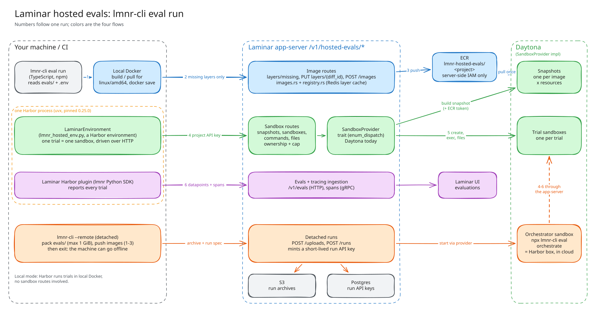

# Hosted evals diagram (temporary branch)

High-level interactions between `lmnr-cli`, the app-server, ECR and Daytona for
`lmnr-cli eval run` (lmnr-ai/lmnr#2618, lmnr-ai/lmnr-ts#325, lmnr-ai/lmnr-skills#16).

- `hosted-evals.excalidraw`: open at https://excalidraw.com (menu → Open) to edit.
- `hosted-evals.png`: has the scene embedded, so it can also be dropped onto excalidraw.com and edited.
- `scene.js`: the generator (Excalidraw element skeletons).
